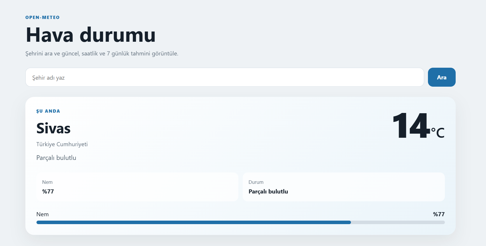

# Weather App(Open-Meteo API + Angular)

## 🎯 Projenin Amacı

Bu proje, **Angular** arayüzünün açık kaynaklı **Open-Meteo API** servislerine doğrudan bağlandığı bir hava durumu web uygulamasıdır. Ayrı bir sunucu (backend) yazılmadığı için kurulum ve bakım yükü azdır; uygulama tek bir Angular projesi olarak çalışır.

Kullanıcı arama çubuğuna bir şehir adı yazdığında şunları görür:

* Şehrin o anki sıcaklığı ve hava durumu (açık, parçalı bulutlu, yağmurlu vb.)
* Nem oranı, yüzdeye bağlı dinamik bir ilerleme çubuğuyla
* Seçilen güne ait saatlik tahmin
* 7 günlük haftalık tahmin (gün başına en yüksek/en düşük sıcaklık, yağış olasılığı ve miktarı, gün doğumu/batımı)

Ek olarak:

* **Şehir önerileri:** Yazım sırasında eşleşen şehirler listelenir (örneğin "ankar" yazınca Ankara, Akara vb.).
* **Otomatik başlangıç:** Sayfa ilk açıldığında boş ekran görünmemesi için "Sivas" için arama otomatik yapılır.

<figure><figcaption></figcaption></figure>

* **Hata yönetimi:** Bulunamayan veya geçersiz bir şehir girildiğinde uygulama çökmez, kullanıcıya hata mesajı gösterilir.

## 🧩 Sistem Mimarisi

### Neden Open-Meteo?

Open-Meteo; ücretsiz, API anahtarı gerektirmeyen ve tarayıcıdan doğrudan çağrılabilen bir servistir. Bu yüzden araya kendi sunucumuzu koymaya gerek kalmamış, **istemci tarafı (client-side) entegrasyon** mimarisi tercih edilmiştir.

**Dezavantajı:** Uygulama harici bir servise bağımlıdır; servis kesintiye uğrarsa uygulama veri alamaz. Ayrıca veriyi sunucuda işleme/önbellekleme imkânı yoktur.

#### İki aşamalı istek mekanizması

Open-Meteo'nun hava durumu servisi (Forecast API) şehir adı kabul etmez, **enlem ve boylam** ister. Bu nedenle sistem iki bağımlı istekle çalışır:

1. **Geocoding API isteği:** Kullanıcının yazdığı şehir adı (örneğin _Sivas_) Open-Meteo Geocoding servisine gönderilir ve şehrin **enlem (latitude)** ile **boylam (longitude)** değerleri alınır.
2. **Forecast API isteği:** İlk adımda alınan koordinatlarla Forecast servisine ikinci bir istek atılır; güncel, saatlik ve günlük hava durumu verileri çekilir.
3. **RxJS zinciri (`switchMap`):** İkinci istek, birincinin sonucuna bağlı olduğu için `switchMap` operatörüyle zincirlenir. Koordinatlar gelince hava durumu isteği başlatılır.&#x20;

### Veri akışı

1. **Kullanıcı girişi:** Kullanıcı arama kutusuna bir şehir adı yazar ve arama tetiklenir. Değer `weather.ts` component’ine(bileşenine) iletilir.
2. **Servis çağrısı:** Component, `weather-api.ts` içindeki `WeatherApi` servisini çağırır. Servis iki isteği zincirleyip sonucu bir `Observable` olarak döndürür. Component bunu `subscribe` eder; `subscribe` edilmeden istek gönderilmez.
3. **Koordinat çözümleme:** Servis önce Geocoding API'ye istek atarak şehrin enlem ve boylam bilgisini alır.
4. **İstek zincirleme (`switchMap`):** Koordinatlar gelince `switchMap` operatörü, bu değerlerle Forecast API isteğini başlatır.
5. **Veri süzme (`map`):** Forecast API'den gelen karmaşık JSON, `map` operatörüyle sadeleştirilir; yalnızca gerekli alanlar (sıcaklık, nem, saatlik ve günlük tahmin vb.) alınır. Sayısal hava kodları da `WEATHER_CODES` ile Türkçe metne çevrilir.
6. **Ekranı güncelleme (`signal`):** İşlenen veri `subscribe` içinde `signal.set(veri)` ile saklanır. Signal'e bağlı ekran parçaları otomatik olarak yenilenir.

**Hata durumu:** Şehir bulunamazsa `throwError` ile akış kesilir. Hata, `subscribe`'ın hata kısmında yakalanır ve kullanıcıya mesaj olarak gösterilir.

## 🛠️ Kullanılan Teknolojiler ve İşlevleri

<table data-search="false"><thead><tr><th>Teknoloji / Araç</th><th>Mimari İçindeki İşlevi ve Kullanım Amacı</th></tr></thead><tbody><tr><td><strong>Angular (v21)</strong></td><td>Arayüzü component'ler halinde geliştirmek için kullanılan TypeScript tabanlı framework. Her component mantık (<code>.ts</code>), görünüm (<code>.html</code>) ve stil (<code>.css</code>) dosyalarından oluşur.</td></tr><tr><td><strong>TypeScript</strong></td><td>Veri tiplerini kodda tanımlayarak hataları çalıştırmadan önce yakalamayı sağlar.</td></tr><tr><td><strong>Signals</strong></td><td>Bir değer <code>.set()</code> ile değiştiğinde, ona bağlı ekran parçasının otomatik güncellenmesini sağlar. API'den gelen hava durumu verisi signal'de tutulur.</td></tr><tr><td><strong>HttpClient</strong></td><td>Angular'ın dış servislere HTTP isteği atma aracıdır. Geocoding ve Forecast isteklerini bu araç gönderir.</td></tr><tr><td><strong>RxJS</strong> (<code>switchMap</code>, <code>map</code>, <code>throwError</code>)</td><td>Asenkron veri akışlarını yönetir. <code>switchMap</code>: koordinattan hava durumuna geçişi zincirler. <code>map</code>: gelen karmaşık JSON'dan sadece gerekli alanları (sıcaklık, nem vb.) süzer. <code>throwError</code>: hatayı kontrollü şekilde arayüze iletir.</td></tr><tr><td><strong>Open-Meteo API</strong></td><td>Ücretsiz, üyelik veya API anahtarı gerektirmeyen açık kaynaklı servis. Geocoding (şehir → koordinat) ve Forecast (hava durumu) verilerini sağlar.</td></tr><tr><td><strong>Node.js / npm</strong></td><td>Angular CLI ve derleme araçlarının çalıştığı JavaScript çalışma ortamıdır. npm ile Angular, RxJS gibi paketler indirilir. Yalnızca geliştirme aşamasında kullanılır, uygulama tarayıcıda çalışır.</td></tr><tr><td><strong>Angular CLI</strong></td><td>Projeyi oluşturma (<code>ng new</code>), çalıştırma (<code>ng serve</code>), test etme (<code>ng test</code>) ve derleme (<code>ng build</code>) için kullanılan komut satırı aracı.</td></tr><tr><td><strong>Git &#x26; GitHub</strong></td><td>Kod versiyon kontrolü ve depolama. Doküman GitBook ile senkronize edilir.</td></tr></tbody></table>

## ⚙️ Projeyi Oluşturma (Sıfırdan)

### **1. Gereksinimleri kontrol et**

```bash
node -v
npm -v
```

### **2. Angular CLI'ı kur**

```bash
npm install -g @angular/cli
ng version
```

### **3. Projeyi oluştur**

```bash
mkdir weather-open-api
cd weather-open-api
ng new frontend
cd frontend
```

`ng new` çalışırken sorulan sorulara bu projede verilen cevaplar:

<table><thead><tr><th width="675.8000183105469">Soru</th><th>Cevap</th></tr></thead><tbody><tr><td>Would you like to share pseudonymous usage data about this project with the Angular Team at Google under Google's Privacy Policy at https://policies.google.com/privacy. For more details and how to change this setting, see https://angular.dev/cli/analytics . (y/N) <br>(Google'ın https://policies.google.com/privacy adresindeki Gizlilik Politikası uyarınca, bu projeye ilişkin takma adla ilişkilendirilmiş kullanım verilerini Google'daki Angular Ekibi ile paylaşmak ister misiniz? Daha fazla bilgi ve bu ayarı nasıl değiştireceğinizi öğrenmek için https://angular.dev/cli/analytics adresini ziyaret edin.(e/H)</td><td><code>N</code> (hayır)</td></tr><tr><td>Stylesheet format</td><td><code>CSS</code></td></tr><tr><td>SSR / prerendering</td><td><code>No</code></td></tr><tr><td>AI tools</td><td><code>None</code></td></tr></tbody></table>


Soruların sırası ve adı CLI sürümüne göre değişebilir.&#x20;


### **4. Component(Bileşen) ve servisi oluştur**

```bash
ng generate component weather
ng generate service weather-api
```

Bu komutlar `weather.ts`, `weather.html`, `weather.css`, `weather.spec.ts` ve `weather-api.ts`, `weather-api.spec.ts` dosyalarını üretir.

### **5. HttpClient'ı etkinleştir**

`src/app/app.config.ts` dosyasındaki `providers` listesine `provideHttpClient()` eklenir. Bu satır `HttpClient`’ı uygulamaya açıkça kaydeder. Bu projede (Angular v21) satır olmadan da istekler çalıştı, ancak açık bırakmak hangi araçla istek atıldığını gösterir ve ileride interceptor gibi ayarlar eklemek için başlangıç noktasıdır.

```typescript
export const appConfig: ApplicationConfig = {
  providers: [
    provideBrowserGlobalErrorListeners(),
    provideRouter(routes),
    provideHttpClient()
  ]
};
```

## ▶️ Projeyi Çalıştırma

### **Hazır projeyi bilgisayara alıp çalıştırmak için:**

```bash
git clone https://github.com/AlimenurAkoz/weather-app.git
cd weather-app/weather-open-api/frontend
npm install
```

#### Geliştirme sunucusu aşağıdaki iki komuttan biriyle başlatılır:

<table><thead><tr><th width="125.79998779296875">Komut</th><th>Açıklama</th></tr></thead><tbody><tr><td><code>npm start</code></td><td><code>package.json</code> içindeki <code>start</code> betiğini çalıştırır. Projeyle birlikte inen yerel Angular CLI'ı kullandığı için Angular CLI'ın global kurulu olmasına gerek yoktur.</td></tr><tr><td><code>ng serve</code></td><td>Angular CLI'ın doğrudan komutudur. Global kurulu <code>ng</code> gerektirir. Ek parametreleri kolayca yazmak için uygundur (örneğin <code>ng serve --port 4300</code>).</td></tr></tbody></table>

`npm start`, arka planda `ng serve` komutunu çalıştırdığı için ikisi aynı sonucu verir. Sunucu başladığında uygulama `http://localhost:4200` adresinde açılır.

### **Diğer komutlar** (yine `frontend` klasöründe):

#### Testleri çalıştırmak için(.spec.ts dosyaları):

`ng` kullanılıyorsa:

```bash
ng test
```

`npm` kullanılıyorsa:

```bash
npm test
```

Testler izleme modunda açılır. Beklenen sonuç:

<div align="left"><figure><figcaption></figcaption></figure></div>

#### Uygulamayı derlemek için:

`ng` kullanılıyorsa:

```bash
ng build
```

`npm` kullanılıyorsa:

```bash
npm run build
```


